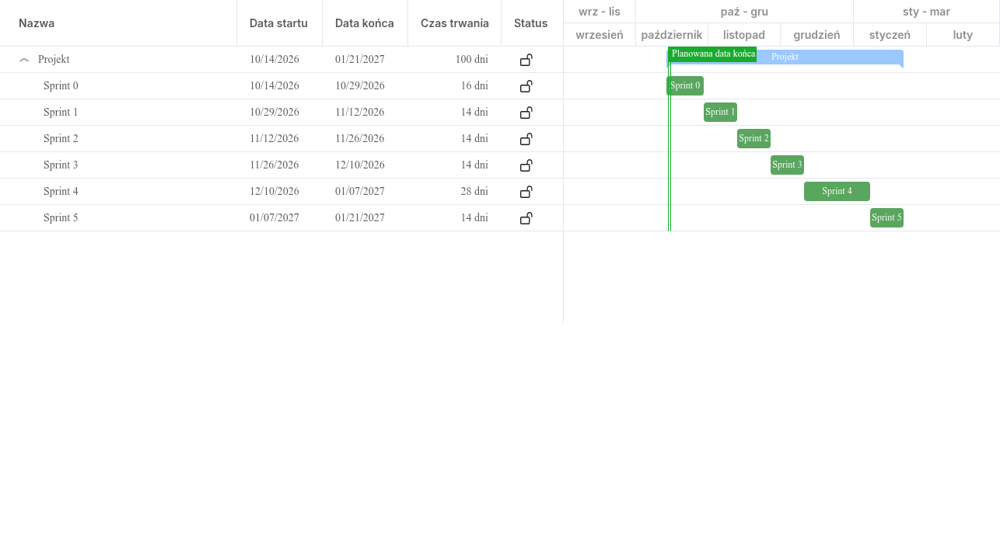

# System zamówień online dla restauracji

Aplikacja internetowa dla małej restauracji. Klient zamawia jedzenie przez stronę i płaci przy odbiorze. Kuchnia widzi zamówienia i zmienia ich status. Właściciel zarządza menu.

Projekt zespołowy systemu informatycznego, Politechnika Opolska, Wydział Informatyki, semestr zimowy 2026/27, grupa 6.

## Wizja

Restauracja przyjmuje wszystkie zamówienia w jednym miejscu, bez kartek i telefonów. Klient zamawia w kilka minut, kuchnia gotuje z jednej listy, a właściciel sam dba o aktualne menu.

## Propozycja wartości

Co zyskuje każdy użytkownik:

- **Klient:** szybko widzi menu z cenami i zamawia bez dzwonienia. Płaci dopiero przy odbiorze. Wie, kiedy jedzenie jest gotowe, więc nie czeka w kolejce.
- **Kuchnia:** ma jedną czytelną listę zamówień w kolejności złożenia. Status zmienia jednym kliknięciem.
- **Właściciel:** sam zmienia menu, ceny i dostępność dań. Klienci nie zamawiają dań, których zabrakło.

## Wymagania biznesowe

Wymaganie biznesowe to cel restauracji, któremu służy system.

1. **WB1.** Wszystkie zamówienia trafiają do jednego systemu, a nie na kartki i do arkusza.
2. **WB2.** Jest mniej pomyłek, bo klient sam wybiera dania z aktualnego menu i widzi łączną kwotę.
3. **WB3.** Klient wie, kiedy odebrać jedzenie, więc nie czeka i nie dostaje zimnego jedzenia.
4. **WB4.** Klient chętnie wraca, bo ma konto i widzi swoje wcześniejsze zamówienia.
5. **WB5.** Właściciel sam zmienia menu, ceny i dostępność dań, bez pomocy informatyka.
6. **WB6.** Restauracja wie, które zamówienia są już opłacone.
7. **WB7.** Tylko uprawnione osoby mogą zmieniać zamówienia i menu.

## Wymagania funkcjonalne

Wymaganie funkcjonalne mówi, co system ma robić.

1. **Menu.** Klient widzi dania w kategoriach, z ceną, opisem i zdjęciem. Dania niedostępne są oznaczone.
2. **Koszyk.** Klient dodaje dania do koszyka i zmienia ich ilość. System liczy łączną kwotę.
3. **Składanie zamówienia.** Klient wybiera: na miejscu albo na wynos. Płaci przy odbiorze. System sprawdza, czy dania są nadal dostępne.
4. **Status zamówienia.** Zamówienie ma status, np. nowe, w przygotowaniu, gotowe, wydane. Klient widzi aktualny status.
5. **Panel kuchni.** Pracownik widzi aktywne zamówienia od najstarszego. Zmienia status jednym kliknięciem. Przy wydaniu oznacza zamówienie jako opłacone.
6. **Panel administratora.** Właściciel dodaje, edytuje i usuwa dania. Oznacza dania jako dostępne albo niedostępne.
7. **Konta i logowanie.** Każde konto ma rolę: klient, pracownik albo administrator. Klient widzi listę swoich zamówień.

## Wymagania niefunkcjonalne

Wymaganie niefunkcjonalne mówi, jaki system ma być.

1. **Szybkość.** Strona odpowiada w mniej niż 2 sekundy, gdy korzysta z niej kilkanaście osób naraz.
2. **Telefon i komputer.** Strona działa w popularnych przeglądarkach (Chrome, Firefox, Edge, Safari) i dobrze wygląda na telefonie.
3. **Prosta obsługa.** Nowy pracownik uczy się obsługi panelu kuchni w 10 minut.
4. **Bezpieczne hasła.** Nie zapisujemy haseł wprost, tylko ich skróty z solą (skrót to „odcisk” hasła, z którego nie da się odczytać hasła). Połączenie ze stroną jest szyfrowane (HTTPS).
5. **Dostęp według ról.** Panel kuchni widzi tylko pracownik i administrator. Panel administratora widzi tylko administrator.
6. **Dane osobowe.** System zbiera tylko dane potrzebne do zamówienia: imię, adres e-mail i hasło. Działamy zgodnie z RODO (unijnymi przepisami o ochronie danych osobowych).

## User stories

User story to jedna potrzeba użytkownika zapisana zdaniem: „Jako [kto] chcę [co], aby [po co]”.
Łańcuch wygląda tak: wymaganie biznesowe → user story → taski (małe kawałki pracy na tablicy zadań).

| Nr | User story | Cel | Sprint |
|---|---|---|---|
| US1 | Jako klient chcę przeglądać menu z podziałem na kategorie i cenami, aby szybko wybrać danie. | WB2 | 1 |
| US2 | Jako klient chcę dodawać dania do koszyka i zmieniać ich ilość, aby przed zamówieniem znać łączną kwotę. | WB2 | 1 |
| US3 | Jako klient chcę złożyć zamówienie na miejscu albo na wynos i zapłacić przy odbiorze, aby nie podawać danych płatniczych w internecie. | WB1 | 2 |
| US4 | Jako klient chcę sprawdzać status zamówienia, aby przyjść po nie, gdy będzie gotowe. | WB3 | 2 |
| US5 | Jako klient chcę założyć konto i się logować, aby widzieć historię swoich zamówień. | WB4 | 3 |
| US6 | Jako pracownik kuchni chcę widzieć aktywne zamówienia w kolejności złożenia, aby żadnego nie pominąć. | WB1 | 2 |
| US7 | Jako pracownik kuchni chcę jednym kliknięciem zmieniać status zamówienia, aby klient wiedział, na jakim etapie jest jego jedzenie. | WB3 | 2 |
| US8 | Jako pracownik chcę przy wydaniu oznaczyć zamówienie jako opłacone, aby wiedzieć, które zamówienia są rozliczone. | WB6 | 2 |
| US9 | Jako właściciel chcę dodawać, edytować i usuwać dania oraz oznaczać je jako niedostępne, aby menu zgadzało się z tym, co kuchnia może przygotować. | WB5 | 3 |
| US10 | Jako właściciel chcę, aby panele kuchni i administratora były dostępne tylko dla kont z odpowiednią rolą, aby klient nie mógł zmieniać zamówień ani menu. | WB7 | 3 |

## MVP

MVP (Minimum Viable Product) to najprostsza wersja systemu, która już działa i daje korzyść. Gotowe MVP pokażemy **11.12.2026**.

W MVP są:

- menu z kategoriami, cenami i oznaczeniem dań niedostępnych,
- koszyk i złożenie zamówienia (na miejscu albo na wynos) z płatnością przy odbiorze,
- podgląd statusu zamówienia przez klienta,
- panel kuchni: lista zamówień, zmiana statusu, oznaczenie „opłacone”,
- panel administratora: zarządzanie menu i dostępnością dań,
- logowanie z rolami: klient, pracownik, administrator,
- konto klienta z listą jego zamówień.

**Rozszerzenia**, jeśli starczy czasu: rezerwacja stolików, opinie i oceny dań, raport sprzedaży.

**Poza zakresem** (świadomie tego nie robimy): płatności przez internet, dostawa do domu, kody SMS przy logowaniu.

## Harmonogram

Pracujemy metodą Scrum. Fazy projektu to sprinty, czyli stałe okresy pracy po 2 tygodnie. Każdy sprint kończy się przeglądem: pokazujemy prowadzącemu działającą część systemu.

| Faza | Termin | Co powstaje | Przegląd |
|---|---|---|---|
| Sprint 0 | 16.10–29.10.2026 | opis produktu, lista user stories, repozytorium, makiety ekranów (proste szkice) | 30.10.2026 |
| Sprint 1 | 30.10–12.11.2026 | baza danych, menu, koszyk | 13.11.2026 |
| Sprint 2 | 13.11–26.11.2026 | składanie zamówienia, panel kuchni | 27.11.2026 |
| Sprint 3 | 27.11–10.12.2026 | logowanie i role, panel administratora | 11.12.2026 (gotowe MVP) |
| Sprint 4 | 11.12.2026–07.01.2027 | rozszerzenie (rezerwacje albo opinie) i testy; przerwa świąteczna 23.12–06.01 | 08.01.2027 |
| Sprint 5 | 08.01–21.01.2027 | poprawki, dokumentacja, prezentacja | 22.01.2027 (oddanie) |

Najważniejsze dni (kamienie milowe): **16.10.2026** plan projektu, **11.12.2026** gotowe MVP, **22.01.2027** oddanie systemu.

### Wykres Gantta

## Zadania

Tablica zadań w GitHub Projects: (https://github.com/s9uu/zespolowy-system-restauracji/projects), zatytułowana **Backlog**

Tablica jest publiczna. Ma kolumny: Do zrobienia, W trakcie i Zrobione. Taski zostały podzielone na kategorie, odpowiednio zaetykietowane i opisane.

## Zespół i role

Wszyscy czworo jesteśmy Developerami, czyli tworzymy system. Dwie osoby mają dodatkowo role ze Scruma.

| Osoba | Rola w Scrumie | Część techniczna |
|---|---|---|
| Maciej Poczkajski | Product Owner (decyduje, co robimy i w jakiej kolejności), Developer | backend: baza danych, statusy zamówień, logowanie i role |
| Mariia Merenkova | Scrum Master (pilnuje sposobu pracy i terminów), Developer | frontend: wygląd aplikacji, panel kuchni, panel administratora; harmonogram |
| Krzysztof Kozielski | Developer | backend: menu, koszyk, zamówienia, zarządzanie menu |
| Fabian Puchała | Developer | frontend: strony dla klienta (menu, koszyk, zamówienie, status, konto); repozytorium i tablica zadań |

## Technologia

Aplikacja internetowa w C# (ASP.NET Core) z bazą SQLite, podzielona na frontend i backend.

- **Frontend** to część, którą widzi użytkownik: strony, przyciski i formularze.
- **Backend** to część „pod spodem”: logika, obliczenia i zapis danych.
- **SQLite** to prosta baza danych zapisana w jednym pliku.
