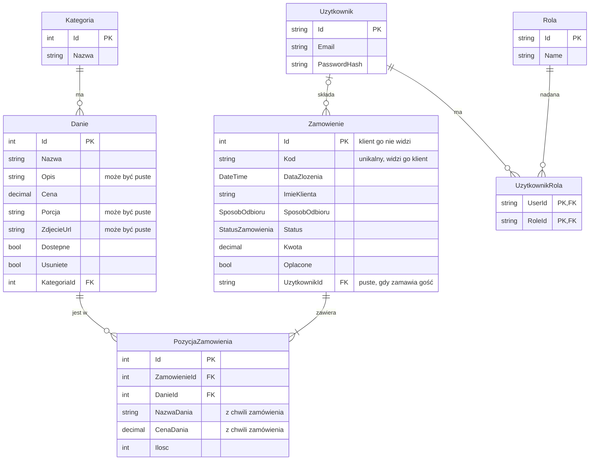

# Model danych

Model danych MVP: baza SQLite przez Entity Framework Core. Bez płatności online i dostawy. Płatność online przez Stripe w trybie testowym dojdzie w Sprincie 4.

## Skąd ten model

Punkt wyjścia to słownik danych z naszego projektu z Inżynierii oprogramowania (magazyny D1 Zamówienia, D2 Menu i D5 Użytkownicy). Uprościliśmy go do MVP:

- Bez dostawy. Sposób odbioru ma tylko dwie wartości: na miejscu i na wynos.
- Bez płatności online. Zamiast magazynu D6 Płatności jest jedno pole `Oplacone` w zamówieniu.
- Bez SMS. Nie zapisujemy numeru telefonu.
- Bez rezerwacji (D3) i opinii (D4), więc nie ma też numeru stolika.
- Konta, hasła i role daje ASP.NET Core Identity. Z danych użytkownika zostają e-mail, hasło (jako skrót z solą) i rola.
- Zostają cztery statusy zamówienia: nowe, w przygotowaniu, gotowe, wydane.
- Kategoria to osobna tabela ze stałą listą w danych startowych. Administrator nie dodaje kategorii.
- Pozycje zamówienia to osobna tabela.
- Nowe względem dokumentu: imię klienta i kod zamówienia w zamówieniu, pola `Porcja` i `Usuniete` w daniu oraz nazwa i cena dania zapisane w pozycji zamówienia.

## Gdzie są te klasy

- Encje są w projekcie `Restauracja.Api`. Aplikacja Web ich nie widzi.
- Enumy są w projekcie `Restauracja.Shared`, bo potrzebują ich i Api, i Web.
- Web dostaje dane tylko jako DTO z `Restauracja.Shared`, np. `DanieDto` ma pole `Kategoria` z nazwą kategorii.
- Koszyk nie ma tabeli. Klient trzyma go w aplikacji Web do chwili złożenia zamówienia. Klasa koszyka (dodawanie, ilość, kwota) jest w `Restauracja.Shared`. Api przy zapisie zamówienia i tak liczy kwotę od nowa z cen w bazie.

## Diagram ERD

Mermaid nie pozwala na znak `?` w typie. Pola, które mogą być puste, są opisane w tabelach niżej.

## Tabele

### Kategoria

Grupuje dania w menu.

| Pole | Typ C# | Opis |
|---|---|---|
| Id | `int` | Klucz główny. |
| Nazwa | `string` | Nazwa kategorii, np. „Zupy”. |

Stała lista w danych startowych: Zupy, Dania główne, Pierogi, Desery, Napoje. Przy daniu administrator wybiera jedną z nich.

**User stories:** US1, US8.

### Danie

Jedno danie z menu, z ceną i dostępnością.

| Pole | Typ C# | Opis |
|---|---|---|
| Id | `int` | Klucz główny. |
| Nazwa | `string` | Nazwa dania, najwyżej 100 znaków. |
| Opis | `string?` | Krótki opis, najwyżej 500 znaków. |
| Cena | `decimal` | Cena w złotych. |
| Porcja | `string?` | Np. „8 szt.” albo „400 ml”, najwyżej 30 znaków. Menu pokazuje ją tylko wtedy, gdy ją podano. |
| ZdjecieUrl | `string?` | Adres zdjęcia, np. /img/zurek.jpg. Pliki zdjęć leżą w `Restauracja.Web/wwwroot`. |
| Dostepne | `bool` | Czy danie można teraz zamówić. Niedostępne widać w menu, ale przycisk „Dodaj do koszyka” jest wyłączony. |
| Usuniete | `bool` | Usunięte danie znika z menu i z panelu, ale zostaje w bazie dla starych zamówień. |
| KategoriaId | `int` | Klucz obcy do tabeli Kategoria. |

`Dostepne` to przerwa na chwilę, np. gdy zabrakło składnika. `Usuniete` to koniec dania w menu. Usuniętego dania nie przywracamy, administrator dodaje je od nowa.

**User stories:** US1, US2, US3, US8.

### Zamowienie

Jedno zamówienie klienta, od złożenia do wydania.

| Pole | Typ C# | Opis |
|---|---|---|
| Id | `int` | Klucz główny. Klient go nie widzi. |
| Kod | `string` | 6 losowych znaków, np. K7F2QX, unikalny. Api losuje go przy złożeniu. Klient po nim sprawdza status, a kuchnia widzi go w panelu. |
| DataZlozenia | `DateTime` | Data i godzina złożenia. Panel kuchni sortuje od najstarszego. |
| ImieKlienta | `string` | Imię, najwyżej 50 znaków. Podaje je każdy klient przy każdym zamówieniu. Widzi je kuchnia, strona statusu go nie pokazuje. |
| SposobOdbioru | `SposobOdbioru` | Na miejscu albo na wynos. |
| Status | `StatusZamowienia` | Aktualny status. Nowe zamówienie ma status Nowe. |
| Kwota | `decimal` | Łączna kwota, liczona przez Api przy złożeniu. |
| Oplacone | `bool` | Na początku false. Pracownik ustawia true przy wydaniu. |
| UzytkownikId | `string?` | Klucz obcy do konta klienta. Puste, gdy zamawia gość. |

Kod zamiast `Id`, bo kolejne numery łatwo zgadnąć i zobaczyć cudze zamówienie.

**User stories:** US3, US4, US5, US6, US7.

### PozycjaZamowienia

Jedno danie w zamówieniu, z ilością. Zamówienie ma co najmniej jedną pozycję.

| Pole | Typ C# | Opis |
|---|---|---|
| Id | `int` | Klucz główny. |
| ZamowienieId | `int` | Klucz obcy do zamówienia. |
| DanieId | `int` | Klucz obcy do dania. |
| NazwaDania | `string` | Kopia nazwy dania z chwili zamówienia. |
| CenaDania | `decimal` | Kopia ceny jednej sztuki z chwili zamówienia. |
| Ilosc | `int` | Liczba sztuk, co najmniej 1. |

Kopia nazwy i ceny jest po to, żeby stare zamówienia pokazywały to, co klient naprawdę zamówił i za ile, nawet po zmianie ceny albo usunięciu dania.

**User stories:** US3, US5, US6, US8.

### Użytkownicy i role (ASP.NET Core Identity)

Konta, hasła i role daje ASP.NET Core Identity. Rozpisujemy tylko tabele, których używamy.

**Uzytkownik** (tabela AspNetUsers, gotowa klasa IdentityUser bez własnych pól). Rejestracja: e-mail i hasło przez gotowe endpointy Identity (`MapIdentityApi`). Konto nie ma imienia, imię klient podaje przy każdym zamówieniu.

| Pole | Typ C# | Opis |
|---|---|---|
| Id | `string` | Klucz główny. Nadaje go Identity. |
| Email | `string` | Służy do logowania. |
| PasswordHash | `string` | Skrót hasła z solą. Samego hasła nie zapisujemy. |

**Rola** (tabela AspNetRoles). Trzy role: Klient, Pracownik i Administrator.

| Pole | Typ C# | Opis |
|---|---|---|
| Id | `string` | Klucz główny. |
| Name | `string` | Nazwa roli. |

**UzytkownikRola** (tabela AspNetUserRoles). Każdy wiersz mówi, że dane konto ma daną rolę. Oba pola razem tworzą klucz główny. U nas każde konto ma jedną rolę.

| Pole | Typ C# | Opis |
|---|---|---|
| UserId | `string` | Klucz obcy do konta. |
| RoleId | `string` | Klucz obcy do roli. |

Startowe konta pracownika i administratora dodajemy w danych startowych. Ich haseł nie wpisujemy w kod, bo repozytorium jest publiczne.

**User stories:** US5, US9.

## Enumy

### StatusZamowienia

| Wartość | Znaczenie |
|---|---|
| Nowe | Klient złożył zamówienie, kuchnia jeszcze nie zaczęła. |
| WPrzygotowaniu | Kuchnia przygotowuje zamówienie. |
| Gotowe | Zamówienie czeka na odbiór. |
| Wydane | Klient odebrał zamówienie. Znika ono z panelu kuchni. |

Status zmienia się zawsze o jeden krok do przodu: Nowe → WPrzygotowaniu → Gotowe → Wydane.

**User stories:** US4, US6, US7.

### SposobOdbioru

| Wartość | Znaczenie |
|---|---|
| NaMiejscu | Klient je w restauracji. |
| NaWynos | Klient zabiera jedzenie ze sobą. |

**User stories:** US3, US6.

EF Core zapisuje enum w bazie jako liczbę, więc nie zmieniamy kolejności wartości, gdy w bazie są już zamówienia.

## Kiedy co powstaje

- Sprint 1 (zadanie 1.1, Maciej): Kategoria, Danie, Zamowienie, PozycjaZamowienia i oba enumy, pierwsza migracja i dane startowe (kategorie i przykładowe menu).
- Sprint 3 (zadania 3.1 i 3.4): tabele Identity i pole `UzytkownikId` w zamówieniu. Wcześniej wszystkie zamówienia są zamówieniami gościa.
- Sprint 4 (zadanie 4.1): pola dla Stripe.

## Sprint 4: co dojdzie dla Stripe

Tylko zarys, szczegóły ustalimy na planowaniu Sprintu 4.

- W tabeli Zamowienie dojdzie pole z identyfikatorem płatności w Stripe, np. `StripeSessionId` (`string?`). Przy płatności przy odbiorze pole jest puste.
- Może dojść pole ze sposobem płatności (przy odbiorze albo online).
- Gdy Stripe potwierdzi płatność, Api samo ustawia `Oplacone` na true.
- Osobnej tabeli płatności nie planujemy.
